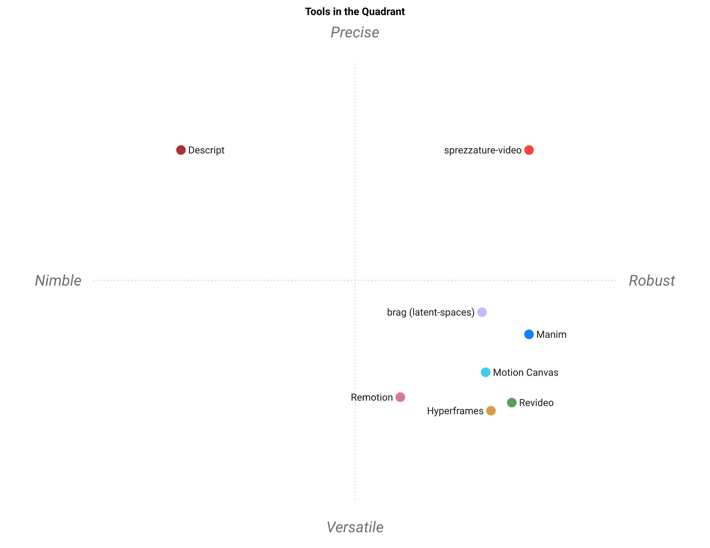

# Paysage

🇫🇷 PAYSAGE.md · [🇬🇧 LANDSCAPE.md](https://github.com/warith-harchaoui/sprezzature-video/blob/main/LANDSCAPE.md)

Tous les outils ci-dessous savent produire une vidéo de projet. Un seul
vérifie si cette vidéo **dit encore la vérité sur le projet** six semaines plus
tard. C'est de cette distinction que parle cette page, et elle n'est pas
flatteuse dans tous les sens : sur l'animation, ce paquet est le plus faible du
tableau.

## Le tableau honnête

| Outil | Licence | Rend | Revendications vérifiées | Audit de reconstruction | Étendue d'animation |
|---|---|---|---|---|---|
| **sprezzature-video** | BSD-3 | délègue | **oui** — dans les deux sens | **oui** — suivi / dérivé / unique, divergence refusée | étroite ; il n'en possède rien |
| [Remotion](https://remotion.dev) | source ouverte, payant en entreprise | React → MP4 | non | les actifs vivent dans le dépôt | très large |
| [Revideo](https://re.video) | MIT | sans écran, orienté bibliothèque | non | les actifs vivent dans le dépôt | large |
| [Motion Canvas](https://motioncanvas.io) | MIT | navigateur, par l'éditeur | non | les actifs vivent dans le dépôt | large |
| [Hyperframes](https://hyperframes.heygen.com/) | Apache-2.0 | HTML → MP4 | non | le registre sait les reprendre | très large |
| [brag](https://github.com/latent-spaces/brag) | MIT | via Hyperframes | non | hérite d'Hyperframes | large |
| [Manim](https://www.manim.community/) | MIT | Python → MP4 | non | les actifs vivent dans le dépôt | large, de forme mathématique |
| [Descript](https://descript.com) | propriétaire, hébergé | hébergé | non | vos médias vivent là-bas | large |

`sprezzature-video` **délègue le rendu exprès**. Hyperframes par défaut,
Playwright et ffmpeg non exclus. Saisir des images est l'étape la plus
banalisée de la chaîne et la moins porteuse d'opinion ; le jugement est dans le
scénario et dans le fait que les revendications survivent au contact du code.

## La carte



```sh
standpoint assets/landscape.csv --outdir assets
```

Produite avec [`standpoint`](https://github.com/warith-harchaoui/standpoint).
La géométrie est une ACP de corrélation, déterministe : la même table donne la
même carte à chaque passage, quel que soit le modèle qui nomme les axes.

À noter : la première table soumise à `standpoint` a été **refusée** —
« criteria with identical columns ». Noter la vérification des revendications
et l'audit des actifs en tout-ou-rien avait fait de deux colonnes une seule :
aucune information ajoutée, et une idée unique comptée deux fois en silence.
Les notes ci-dessus sont les corrigées : la reconstructibilité est bel et bien
un dégradé, et un outil doté d'un registre d'actifs reprenables n'est pas au
même endroit qu'un outil qui espère que les fichiers sont encore là.

## Ce que la forme dit vraiment

Les deux axes expliquent 86 % de la variance, et le second est la moitié
intéressante :

- **Agile ↔ Robuste** est porté par l'auto-hébergement (0,51), le code d'abord
  (0,48) et la licence ouverte (0,48). Il sépare l'éditeur hébergé de tout ce
  qu'un développeur lance lui-même. Rien de surprenant n'habite ici.
- **Polyvalent ↔ Précis** est porté par la vérification des revendications
  (**+0,60**) contre l'étendue d'animation (**−0,54**). L'axe dit, presque
  littéralement : *est-ce qu'il vérifie ce qu'il affirme* contre *est-ce qu'il
  sait tout animer*.

La carte place donc `sprezzature-video` seul en haut à droite, et les moteurs
de rendu groupés en bas à droite. Ce n'est pas ce paquet qui les bat. C'est ce
paquet **qui n'est pas dans leur concours** : ils s'affrontent sur ce qu'on
peut dessiner, et personne dans ce groupe n'essaie de confronter un nombre à un
catalogue, parce que ce n'est pas le métier d'un moteur de rendu.

La lecture pratique : pour un film qui peut tout dire, prenez un des moteurs.
Pour un film dont les affirmations tiennent encore après que le projet a bougé,
il faut aujourd'hui ajouter cette couche soi-même — ou prendre celle-ci.

## Quand prendre autre chose

- **Il vous faut de la vraie animation** — particules, 3D, personnages.
  Remotion, Revideo et Hyperframes font tous mieux que quoi que ce soit ici, et
  ce paquet est content de les piloter.
- **Votre vidéo n'affirme rien de factuel.** Une pièce d'ambiance, un
  générique, une bande démo. Tout l'appareillage d'ici devient du poids mort.
- **Vous voulez monter à la main, sur une ligne de temps.** Descript, Premiere,
  Resolve. Une spécification déclarative est la mauvaise forme pour ce travail.
- **Vous êtes déjà profondément dans React.** Remotion vous coûtera moins, si la
  licence convient — elle est à source ouverte, pas libre, ce qui compte quand
  on assemble une pile sous BSD.

## Voir aussi

- [BOUNDARIES.md](BOUNDARIES.md) — qui possède quoi, entre cette suite et
  ai-helpers.
- [sprezzature-figures](https://github.com/warith-harchaoui/sprezzature-figures)
  et [sprezzature-maps](https://github.com/warith-harchaoui/sprezzature-maps) —
  ce qui apparaît *dans* le cadre.
- [sprezzature-audio](https://github.com/warith-harchaoui/sprezzature-audio) —
  la voix et les sous-titres.
